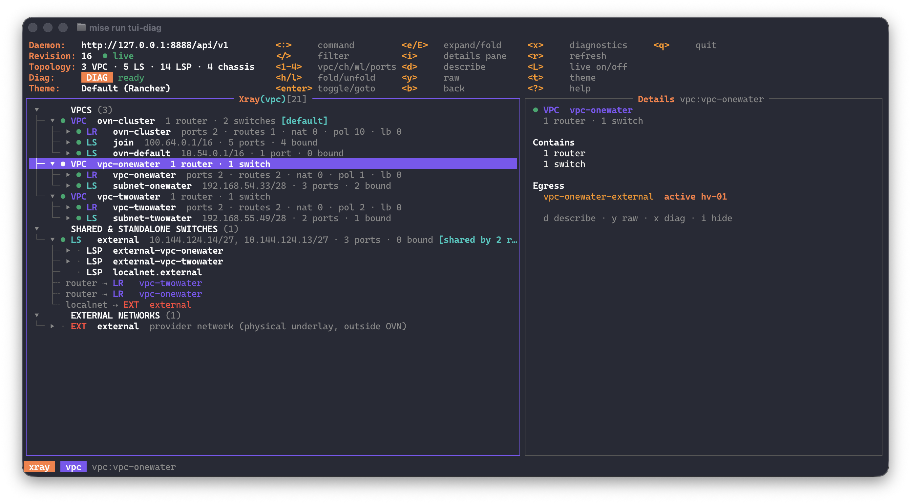
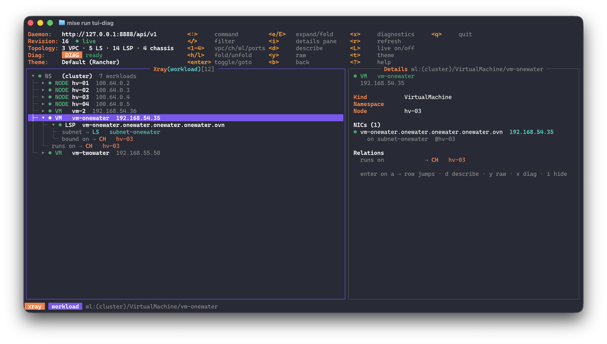

# OVN Topology TUI Guide (`ovn-topo`)

`ovn-topo` is a k9s-style terminal explorer for the topology served by `ovn-topologyd`. You navigate **xray trees** (objects and what they contain) and a **`:ports` table** (the router-port matrix), follow **relations** (`⇢`) between objects, read a **details pane** that explains the selection, and run Tier 1 diagnostics on whatever is selected.

```bash
ovn-topo --daemon-url http://127.0.0.1:8080/api/v1   # live daemon (mise run tui)
ovn-topo --fixture                                   # bundled dataset, offline (run from the repo root)
ovn-topo --diag                                      # + Tier 1 exec diagnostics (ADR-0001)
```

Part 1 is organised by **use case**: the question you have, the keys to press, what to look at. Each use case has a **TUI | Harvester** screenshot pair. Part 2 is the **reference** for every screen.

> **Screenshots.**
> - TUI captures go in `docs/images/tui/`, Harvester captures in `docs/images/harvester/`, named `ucNN-<topic>.png` as in the placeholders.
> - The Harvester locations are *suggested*: check the exact menu names in your Harvester version when capturing.

---

## 1. Screen layout

```text
 Daemon:   http://127.0.0.1:8080/api/v1        <:>     command         <e/E>   expand/fold     <r>  refresh
 Revision: 1842  ● live                        </>     filter          <i>     details pane    <L>  live on/off
 Topology: 2 VPC · 4 LS · 412 LSP · 3 chassis  <1-4>   vpc/ch/wl/ports <d>     describe        <t>  theme
 Diag:     DIAG ready                          <h/l>   fold/unfold     <y>     raw             <?>  help
 Theme:    SUSE                                <enter> toggle/goto     <b>     back            <q>  quit
┌──────────────────────── Xray(vpc)[18] ─────────────────────────┐┌───────── Details lr:lr-default-uuid ─────────┐
│ ▾      VPCS (2)                                                ││ ● LR   ovn_cluster                           │
│ ├─ ▾ ● VPC  default  1 router · 1 switch [default]             ││   ports 3 · routes 1 · nat 0 · pol 1 · lb 1  │
│ │  ├─ ▸ ● LR   ovn_cluster  ports 3 · routes 1 · nat 0 · pol 1 ││                                              │
│ │  └─ ▸ ! LS   default-subnet  10.244.0.1/24 · 412 ports · 1 u…││ Ports & interconnections (3)                 │
│ └─ ▾ ● VPC  custom-vpc  1 router · 1 switch                    ││ • lrp-default  10.244.0.1/24                 │
│    ├─ ▸ ● LR   custom-vpc  ports 2 · routes 0 · nat 1 · pol 0  ││     → LS   default-subnet                    │
│    └─ ▸ ● LS   custom-subnet  10.100.0.1/24 · 2 ports · 1 bound││ • lrp-gw                                     │
│ ▾      SHARED & STANDALONE SWITCHES (2)                        ││     Active GW on node-1                      │
│ └─ ▾ ● LS   join  100.64.0.2/16, 100.64.0.1/16 [shared by 2 r…]││ • lrp-join-def  100.64.0.1/16                │
│    ├╌ router ⇢ LR   custom-vpc                                 ││     → LS   join  (shared interconnect)       │
│    └╌ router ⇢ LR   ovn_cluster                                ││ L3  Routes 1 · Policies 1 · NAT 0 · LBs 1    │
└────────────────────────────────────────────────────────────────┘└──────────────────────────────────────────────┘
 xray  vpc  lr:lr-default-uuid
```

- **Header (5 rows):**
  - daemon address;
  - revision and live state: `● live` over SSE, `◌ polling` when the stream is unavailable, `‖ paused`, `○ offline fixture`;
  - topology totals, diagnostics state, theme;
  - the hotkeys of the current screen.

  Terminals shorter than 18 rows get a one-line header.
- **Main box:** the title shows the screen (`Xray(vpc)`, `Ports(lrp)`, `Describe(lsp)`…), the row count and the active filter (`</pod>`).
- **Details pane** (right side, on terminals at least 100 columns wide): explains the selected object and how it interconnects. `i` hides or shows it.
- **Crumbs (bottom row):** `xray`/`table` › current root › selected object ID, and on the right any message (jump targets, errors, refresh failures).

Every frame is laid out to exactly the terminal size: nothing scrolls off the top, and lists scroll to keep the cursor visible.
- Tree rows and table cells that do not fit are cut with `…`; the details pane carries the full information.
- Describe and raw views wrap long values instead.

---

# Part 1 — Use cases

## UC1. What is in this VPC and how is it wired?

**Keys:** `1` → select a VPC, then its router (`LR`).

- The tree opens two levels: each VPC with its routers and switches, folded. `l` / `Space` unfolds a router into its ports (`LRP`) and a switch into its ports (`LSP`).
- The details pane on the router lists **Ports & interconnections**: each router port with its networks, the switch it connects to (`shared interconnect` when several routers use it), its MAC, and the active gateway chassis for centralized ports.
- **L3** shows the route, policy, NAT and load-balancer counts. The rows themselves are not listed yet (see *Known traps*).

| TUI | Harvester |
|---|---|
|  |  |
| `1`, VPC unfolded, cursor on its LR | *Suggested:* Networks › Virtual Private Cloud › *vpc* |

## UC2. Where does my VM run and how does its traffic leave?

**Keys:** `3` → namespace → VM → its NIC (`LSP`).

- **Workload xray:** namespace → VM / Pod / Node → NICs. A KubeVirt VM is shown as the VM, not its `virt-launcher` pod.
- The NIC's pane shows its IP and MAC, the **chassis it is bound on** (OVN's `Port_Binding`), and the **Path out**: `LSP → LS (cidr) → LRP gw <ip> → LR (VPC)`.
- `✗ [unbound]` means OVN has not placed the port on any host (see UC4).

| TUI | Harvester |
|---|---|
|  |  |
| `3`, VM → NIC selected, details pane | *Suggested:* Virtual Machines › *vm* › Network |

## UC3. A VM with several NICs on different networks

**Keys:** `3` → a VM with two NICs.

- One workload row, with one NIC child per network (switch), each with its own IP and chassis.
- `x` on the VM first asks **which NIC** the diagnostics should use; it never silently picks the first one.

| TUI | Harvester |
|---|---|
|  |  |
| `3`, VM unfolded: NICs on two switches | *Suggested:* Virtual Machines › *vm* › Edit Config › Networks |

## UC4. Why is a pod or VM not working? (unbound port)

**Keys:** `/pending` (or the name), or scan for `✗` / `!`.

- `✗ [unbound]` on a port: no chassis claims it (`Port_Binding.chassis` is empty). The workload is scheduled but OVN has not wired it.
- `!` on a switch: it has unbound ports. The summary says how many.
- The pane says `Bound on: unbound — no Port_Binding.chassis`. Diagnostics that need a host are disabled with that reason.

| TUI | Harvester |
|---|---|
|  |  |
| `/pending`, unbound LSP selected | *Suggested:* Virtual Machines list, VM in *Starting* / *Unschedulable* |

## UC5. How do VPCs reach each other and the nodes? (shared switches)

**Keys:** `1` → *Shared & standalone switches*.

- `join` connects every VPC router to every node's `ovn0` (100.64.0.0/16 by default). An external switch can be shared by several VPCs.
- `[shared by N routers]` plus one `router ⇢` relation per router. `Enter` on a relation jumps to that router.
- The pane lists the **connected routers**: router, VPC, through which port and network.

| TUI | Harvester |
|---|---|
|  |  |
| `1`, `join` unfolded with `router ⇢` relations | *Suggested:* Networks › Virtual Private Cloud (VPCs and their subnets) |

## UC6. How does a VPC reach the outside? (gateway, EIP, underlay)

**Keys:** `4` (`:ports`), then `1` → *External networks*.

- In `:ports`, a centralized gateway row shows `active <chassis>`. The inspector says **Centralized**: traffic leaves through the chassis that holds the `cr-<port>` redirect port.
- A subnet gateway row is **Distributed**: every chassis routes it locally.
- *External networks* lists the provider network (the physical underlay) with its `localnet from ⇢` switch.

| TUI | Harvester |
|---|---|
|  |  |
| `4`, gateway row + inspector | *Suggested:* Networks › Virtual Machine Networks |
|  |  |
| `1`, External networks unfolded | *Suggested:* Networks › Cluster Network Configuration |

## UC7. Which host runs what, and how does a chassis map to a node?

**Keys:** `2` → a chassis.

- **Chassis xray:** each chassis with the ports bound on it and `active gateway for ⇢ LRP`.
- The pane shows the **System-id** (the chassis identity), hostname, encap (tunnel) IP, and `Node hv-01 ← <rule>`. The rule says how the node was matched: the `ovn.kubernetes.io/chassis` node annotation, the hostname, or a fallback.
- **Warnings:**
  - hostname-only match;
  - several chassis with the same hostname (a stale chassis after a reinstall);
  - an interconnect chassis.

| TUI | Harvester |
|---|---|
|  |  |
| `2`, chassis selected, details pane | *Suggested:* Hosts › *hv-01* |

## UC8. Follow a relation and come back

**Keys:** unfold a port (`l`), `Enter` on `bound on ⇢ CH …`, then `b`.

- `Enter` jumps to the object in the xray where it lives: a chassis opens the chassis xray, a workload the workload xray. The path to it is expanded, and the crumbs say where you jumped.
- `b` returns to the exact row you left. On a `⇢` row the details pane already describes the target.

| TUI | Harvester |
|---|---|
|  | — |
|  | — |

## UC9. What does OVN really store for this object?

**Keys:** `d` (describe), then `y` (raw).

- **Describe:** graph properties, Kubernetes identity (namespace, owner, VMI, node, NAD), relations, children, NB `external_ids`. Long maps unfold one entry per line.
- **Raw:** the OVSDB row, pretty-printed like `jq` and keyed by OVSDB column names (`_uuid`, `hostname`, `other_config`…). The title names the table, e.g. `SB Chassis row`.

| TUI | Harvester |
|---|---|
|  |  |
|  | *Suggested:* Virtual Machines › *vm* › ⋮ › Edit YAML |

## UC10. Will this packet get through? (`ovn-trace`)

**Keys:** `--diag`, select a VM NIC, `x` → `1`, pick a destination, `Enter`.

- The modal header shows the **captured target**: port, datapath, IP/MAC, and the node with where it comes from.
- **Destination tabs (`Tab`):** VM, Pod, Gateway, **Node ovn0** (a node's port on the join switch, inside OVN), **Underlay** (the chassis tunnel IP, outside OVN), Public DNS. You can also type an IP, or `IP:port`.
- **Result:** the verdict (`DELIVERED` / `DROPPED`), the hop-by-hop path and the pipeline stages. `o` shows the raw output.

| TUI | Harvester |
|---|---|
|  | — |
|  |  |
|  | *Suggested:* Virtual Machines › *vm* › Console (ping the same destination) |

## UC11. Show me the live traffic (`tcpdump`)

**Keys:** `x` → `2` on a VM NIC; or on the join router port `ovn-cluster-join`, `x` → `2`, then choose a chassis.

- **VM or pod NIC:** captures on its host veth (`<hash>_h`), on the node where OVN binds the port.
- **Join router port:** it runs on every chassis, so you pick one (`c` changes it later). The capture runs on that node's `ovn0`, filtered on the router port IP.
- **Presets:** port IP, ICMP, TCP, SSH, web, DNS, or a custom BPF filter. `Space` / `Esc` stops the capture.

| TUI | Harvester |
|---|---|
|  |  |
|  | *Suggested:* Virtual Machines › *vm* › Console |

## UC12. Node-level checks

**Keys:** `2` → a chassis, `x` → `3` / `5` / `6`.

- **`3` conntrack:** filtered on the port IP when started from a port, unfiltered from a chassis.
- **`5` `ovs-vsctl show`:** bridges, the Geneve tunnel mesh, BFD.
- **`6` `ovn-controller` logs** of that node.

| TUI | Harvester |
|---|---|
|  |  |
|  | *Suggested:* Hosts › *hv-01* › Network |

## UC13. Watch a change happen (live migration, VM start)

**Keys:** keep a view open, with the header showing `● live`.

- Each change on the daemon's event stream refetches only what changed. Changed rows flash for 3 s.
- A migrating VM's NIC moves from one chassis to another. With the diagnostics modal open on it, the modal warns `moved: hv-01 → hv-02` and re-targets the new node.
- `L` pauses and resumes the live updates; `r` reloads everything.

| TUI | Harvester |
|---|---|
|  |  |
|  | *Suggested:* Virtual Machines › *vm* › ⋮ › Migrate |

---

# Part 2 — Reference

## 2. Xray trees — `1` `2` `3`

| Key | Root | Tree |
|---|---|---|
| `1` / `:xray vpc` | VPCs, shared & standalone switches, external networks | VPC → LR → LRP · VPC → LS → LSP |
| `2` / `:xray chassis` | chassis | chassis → LSPs bound there (+ active gateway roles) |
| `3` / `:xray workload` | Kubernetes namespaces | namespace → VM / Pod / Node → its NICs (LSPs) |

- **Rows:** fold marker (`▾`/`▸`), health glyph, kind tag, name, a dim summary (CIDR, IP, `@chassis`, counts) and a badge (`[unbound]`, `[GW active hv-01]`, `[shared by 2 routers]`).
- **Relations (`├╌ label ⇢ …`)** appear when you unfold an object.
  - They are graph edges, not ownership: `bound on` (chassis), `workload`, `router port`, `peer switch`, `peer port`, `gateway (active)`, `localnet`, and `router` (for shared switches).
  - A relation already visible as the parent or a sibling is not repeated.
- **`Enter` on a relation jumps** to that object in the xray where it lives, expanding the path to it. **`b`** returns to the exact row you left.
- **Two levels start open:**
  - In the VPC xray you see each VPC's routers and switches with their summaries, folded. Router ports, switch ports and relations appear when you unfold.
  - Large switches, chassis and namespaces (more than 16 children) start folded even at the top.
  - `e`/`E` unfolds/folds everything visible; repeat it to go deeper.
- A multi-NIC KubeVirt VM is one workload row whose children are its NICs on different switches.

### Details pane — `i`

On terminals at least 100 columns wide, the right pane describes the selection. On a `⇢` row it describes the target, i.e. where `Enter` goes. With the pane shown, port rows drop their inline summary, because the pane carries it.

| Selection | Pane |
|---|---|
| Router | **Ports & interconnections**: each LRP with networks, peer switch (`shared interconnect`), MAC, active gateway · **L3** counts (routes, policies, NAT, LBs) + the NAT trap note. The route, policy and NAT rows themselves are planned (ROADMAP M2, follow-up "LR routes, policies & NAT") |
| Router port | Router/VPC, networks, MAC, peer switch + summary, peer LSP, routers on that switch, gateway, role, **routing** (distributed vs centralized) and what the port is for |
| Switch | **Connected routers** (router, VPC, via which LRP and network) · port counts · localnet underlay |
| Switch port | Type, IP, MAC, workload, bound chassis (or **unbound**) · **Path out**: `LSP → LS → LRP gw → LR (VPC)` |
| Chassis | System-id, hostname, node **and the rule that linked it** (annotation / hostname / fallback), `_uuid`, encaps, bound ports, **active gateway for**; warnings for hostname-only matches, shared hostnames and interconnect chassis |
| Workload | Kind, namespace, node, each NIC with IP, switch and chassis |
| VPC | Contents and **egress** gateways |

Every pane ends with the Kubernetes identity and the object's relations (`label ⇢ object`).

### Health glyphs

| Glyph | Meaning |
|---|---|
| `●` (green) | OK: port bound, switch fully bound, chassis present |
| `!` (yellow) | Degraded: switch with unbound ports, disabled port |
| `✗` (red) | Unbound port (no `Port_Binding.chassis`) or a workload with such a NIC |
| `·` (dim) | Infrastructure port (`router`, `localnet`, …): never reported as unbound |

Shapes and colours both carry the state, so it stays readable without colour.

## 3. Router-port table — `4` / `:ports`

The Port Matrix as a resource table: one row per logical router port, including gateway ports known only from the router's properties.

- **Columns:**
  - VPC, router port, networks;
  - peer switch (`*` = shared by more than one router);
  - MAC;
  - gateway (`distributed` or `active <chassis>`);
  - role (`subnet gateway`, `node transit (join)`, `interconnect`, `external gateway`).

  On narrow terminals MAC, then ROLE, then NETWORKS are hidden instead of wrapping.
- **`s` / `S`** cycles the sort column / reverses it (the header shows `↑`/`↓`). **`/`** filters across all columns.
- **Inspector (bottom):** router and VPC, peer switch and its summary, peer LSP, routers on that switch, gateway, the routing mode (distributed vs centralized) and a one-line explanation of the port's role. It docks when the terminal is tall enough; **`i`** toggles it.
- **`Enter`** opens the port in the VPC xray, and **`b`** comes back to the same table row. **`d`** / **`y`** describe it.

## 4. Describe & raw — `d` / `y`

- **`d` (describe):** everything known about the selected object:
  - graph properties;
  - Kubernetes identity (namespace, owner, VMI, node, NAD);
  - relations and children;
  - the daemon's `/node/{id}` detail (external_ids, related objects).

  Maps and lists that do not fit unfold one entry per line, and long values wrap.
- **`y` (raw):** the OVSDB row from the daemon.
  - Pretty-printed like `jq`: indented, sorted keys, coloured keys, strings and numbers.
  - Keyed by **OVSDB column names** (`_uuid`, `hostname`, `other_config`, as `ovn-sbctl list` shows them).
  - The title names the table, e.g. `Raw(chassis) hv-01 — SB Chassis row`.
  - Long values wrap at the box edge. Only colour is added, so the text stays valid JSON once the wraps are removed.
- **Navigation:** `j`/`k` scroll, `ctrl+d`/`ctrl+u` half a page, `g`/`G` top/end, `Esc` returns.

## 5. Filter, commands, live updates

- **`/text`:** substring filter on name, summary and badge.
  - Matching rows are shown with all their ancestors, so you keep the context: `/pod-2` shows `VPCs › default › default-subnet › app-pod-2.default`.
  - `Esc` clears it.
- **`:`:** command prompt with `Tab` completion: `xray vpc|chassis|workload`, `ports` (`lrp`, `matrix`), `theme <name>`, `quit`.
- **Live updates:** the TUI subscribes to `/events` (SSE).
  - Each event refetches the L3 graph and only the switches whose ports changed. Unknown IDs fall back to all switches.
  - If the stream breaks, it polls `/graph` every 10 s with `If-None-Match` and keeps retrying SSE.
  - Rows whose content changed flash for 3 s.
  - `L` pauses/resumes; `r` forces a full reload.
- **Ports are fetched completely:** L2 pages (200 ports each) are followed until the last one.

## 6. Tier 1 Diagnostics — `x` (requires `--diag`)

`x` opens the diagnostics modal for the selection: a switch port (LSP), a workload (asking which NIC when it has several), a router port or a chassis.
- Switches, routers, groups, namespaces, VPCs and external networks are not traffic endpoints, so `x` asks you to select a port or a chassis instead.
- Without `--diag`, or when RBAC denies `pods/exec`, `x` explains why instead of failing.

| Key | Action |
|---|---|
| `1` | **`ovn-trace`.** Destination picker with fzf-style search and custom IP (`10.144.97.201` or `10.144.97.201:22`). Category tabs (`Tab`): All / VM / Pod / Gateway / **Node ovn0** (a node's port on the join switch, inside OVN) / **Underlay** (the chassis tunnel IP, outside OVN) / Public DNS. Protocol presets: `Ctrl+P`, `F1`–`F5` (ICMP, TCP 22/80/443, UDP 53). The microflow starts at the **selected** port (inport, MAC, IP); traffic leaving the subnet gets the router's MAC as `eth.dst`. Output: verdict, hop-by-hop path, pipeline stages; `o` toggles raw output |
| `2` | **Live tcpdump** on the port's own host interface: its veth (`<hash>_h`), looked up by `external_ids:iface-id` on the port's node. A centralized gateway port uses `br-external` on the active chassis; the join router port uses the chosen node's `ovn0`. Presets or a custom BPF filter. `Space`/`Esc` stops the capture |
| `3` | **Conntrack** on the node: filtered on the port IP from a port, unfiltered from a chassis |
| `4` | **OVS port interface:** link state, ofport, MTU, rx/tx counters of the port's OVS interface |
| `5` | **`ovs-vsctl show`** on the node: bridges, tunnels, BFD |
| `6` | **`ovn-controller` logs** on the node |
| `c` | **Choose the chassis** for a distributed router port |

Commands come from the typed allowlist in `pkg/diag`; nothing is built from free-form strings.

### What `x` acts on

The target is captured when you press `x` and shown at the top of the modal: the object (kind, name, ID), its datapath, IP/MAC, and the node with **where that node comes from**.
- Every action runs on exactly that target.
- Nothing is borrowed from another object.
- What cannot be derived from the selection is listed as *unavailable*, with the reason.

| Selection | Trace from | Node actions run on | Unavailable |
|---|---|---|---|
| Workload port (LSP) | the port itself (its switch, IP, MAC) | its **Port_Binding chassis** | node actions if the port is unbound |
| Infrastructure port (router / localnet) | the port, if it has an IP | — | tcpdump, conntrack, OVS port, bridges, logs |
| Router port (LRP), centralized | the router datapath, from this port | the **active gateway chassis**; tcpdump on `br-external` | OVS port |
| Router port (LRP), distributed | the router datapath, from this port | **the chassis you pick** (`c`, or asked on the first node action); tcpdump on that node's `ovn0` for the join port | OVS port; tcpdump for non-join ports (routed inside OVS, no host interface) |
| Chassis | — | that chassis | trace, tcpdump, OVS port |
| Workload (VM / Pod) | its NIC; **with several NICs you pick one first** | that NIC's chassis | as for its NIC |
| Switch, router, VPC, namespace | — | — | everything (select a port or a chassis) |

- **Kubernetes vs OVN node:** if Kubernetes reports a different node than OVN's binding (e.g. during live migration), the modal warns and uses the OVN binding.
- **Live updates while the modal is open:** they re-check the target by ID.
  - If the target disappears, the modal says so and disables the actions.
  - If it moves to another chassis, you are told and the node is updated.
  - A chosen chassis is kept.
- **tcpdump and OVS port** look up the interface whose `external_ids:iface-id` is the port, on the port's node. If none exists, the action fails with that message: it never captures on `ovn0`, `br-int` or another node instead.

## 7. Known traps (by design, also shown in `?` help)

- **VPC NAT Gateway (`Iptables*`) NAT is iptables inside a pod**, not OVN NAT. It never appears in the NB `NAT` table or in the router's `nat` count.
- **Default-VPC `natOutgoing` in centralized mode** is an LR policy reroute plus node iptables, not NB `NAT`.
- **Routes, policies and NAT rows are not listed yet.** The pane and `d` show counts only, and `y` on a router shows just the row UUIDs. To see the rows:
  ```bash
  kubectl ko nbctl lr-route-list <router>     # static routes (prefix, nexthop, output port, policy)
  kubectl ko nbctl lr-policy-list <router>    # policies by priority
  kubectl ko nbctl lr-nat-list <router>       # SNAT / DNAT / FIP
  ```
  On the default VPC, most policies are Kube-OVN's subnet `allow` rules plus per-node `reroute` rules to node join IPs (`100.64.x.x`).
- **A chassis is an `ovn-controller`, not a hostname.**
  - Its identity is `Chassis.name`, the host's OVS `system-id`.
  - Kube-OVN publishes it on the Node as `ovn.kubernetes.io/chassis`, and that annotation is how a chassis is mapped to a node.
  - `Chassis.hostname` is informational and only a fallback.

  It is normally one chassis per host, but not always:
  - a reinstalled host (new system-id) can leave a stale chassis with the same hostname;
  - an OVN-IC or VTEP chassis is not a host of this cluster;
  - a node whose `ovs-ovn` is not running has no chassis.

  The chassis pane shows which rule matched and flags these cases.
- **A switch can attach to several routers** (e.g. `join`, or an external switch shared by VPCs). It is listed under *Shared & standalone switches* with `[shared by N routers]` and `router ⇢` relations to each.

## 8. Keys

| Where | Keys |
|---|---|
| Everywhere | `1`–`4` switch view · `:` command · `/` filter · `?` help · `r` refresh · `L` live on/off · `t` theme · `b` back · `x` diagnostics · `q` quit |
| Xray trees | `j`/`k` move · `g`/`G` top/bottom · `ctrl+d`/`ctrl+u` half page · `h`/`l` fold/unfold · `Space` toggle · `Enter` toggle or jump (`⇢`) · `e`/`E` expand/fold all · `i` details pane · `d` describe · `y` raw |
| `:ports` | `j`/`k` · `g`/`G` · `s`/`S` sort / reverse · `i` inspector · `Enter` open in xray · `d`/`y` describe |
| Describe / raw | `y` toggle raw · `j`/`k` · `ctrl+d`/`ctrl+u` · `g`/`G` · `Esc` back |
| Diagnostics menu | `1`–`6` actions · `c` choose chassis (distributed port) · `Esc`/`x` close |
| Trace picker | type to search or enter an IP · `Tab`/`Shift+Tab` category · `Ctrl+P`, `F1`–`F5` protocol · `↑`/`↓` · `Enter` trace · `Esc` back |
| tcpdump | `1`–`6` preset · type a custom filter · `Enter` start · `Space`/`Esc` stop |
| Results | `j`/`k`, `PgUp`/`PgDn` scroll · `o` raw output · `Esc` back · `x` close |
